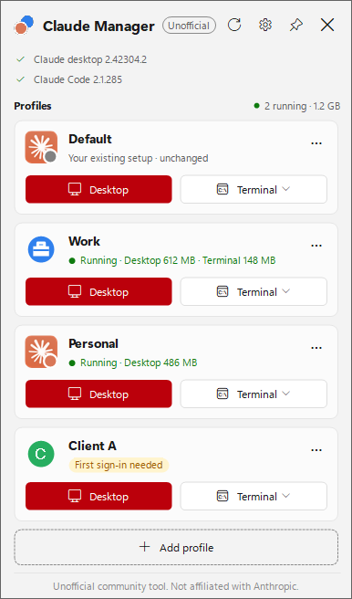
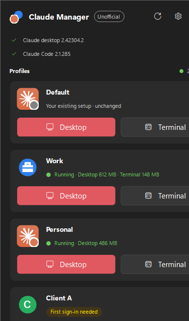
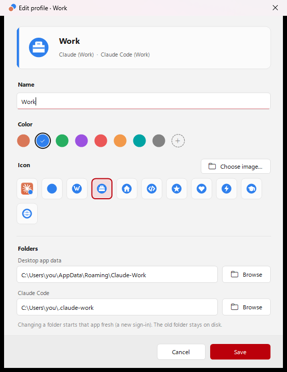
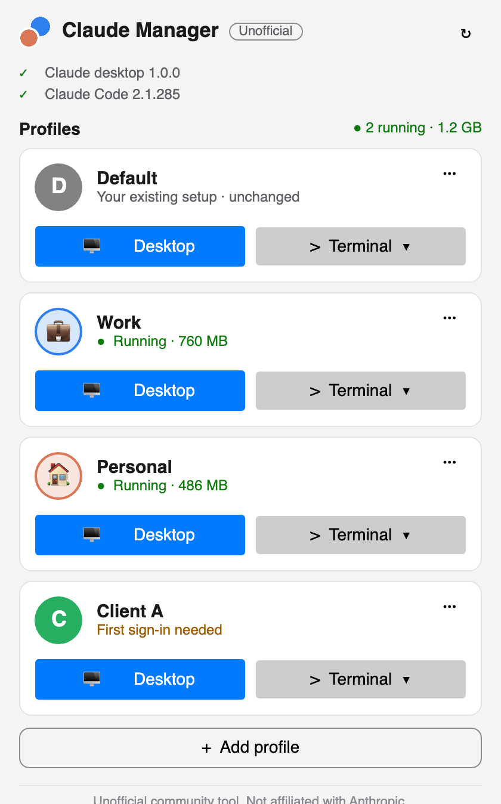

# Claude Manager: run multiple Claude accounts on one machine (Windows & macOS)

[](https://github.com/madil9966/claude-manager/releases/latest)
[](#install)
[](https://github.com/madil9966/claude-manager/actions/workflows/release.yml)
[](LICENSE)

**Claude Manager is a free, open-source account switcher for Claude.** It lets you **run multiple Claude accounts on one machine at the same time**, for example **Work and Personal** on the same PC or Mac, in both the **Claude desktop app** and **Claude Code (CLI)**. No more logging out and back in to switch accounts.

Each account (a *profile*) gets its own Claude window and its own Claude Code terminal, so you can have a work account and a personal account open at once. On Windows, sign-in links, including **Google sign-in**, are sent to the right profile.

> **Unofficial community tool.** Claude Manager is not affiliated with, endorsed by, sponsored by, or supported by Anthropic. "Claude" is a trademark of Anthropic, PBC, used here only to describe the app this tool works with. No Anthropic software or assets are included.

**[⬇ Download for Windows or macOS](https://github.com/madil9966/claude-manager/releases/latest)** · [Website](https://madil9966.github.io/claude-manager/) · [FAQ](#faq) · [How it works](#how-it-works)

| Windows: light | Windows: dark |
|---|---|
|  |  |

| Add or edit a profile | macOS |
|---|---|
|  |  |

*Screenshots use sample profiles.*

## Features

- **Use multiple Claude accounts at the same time.** Each profile opens its own Claude desktop window with its own login, chats and settings.
- **Claude Code with different accounts.** A Terminal button opens Claude Code with that profile's `CLAUDE_CONFIG_DIR`, so `claude` runs as that account in that window only.
- **Google sign-in works (Windows).** `claude://` sign-in links go to the profile being set up, not to whichever Claude window happens to be open.
- **Your existing setup is never touched.** `~/.claude`, `~/.claude.json` and Claude's app data stay exactly as they are. Your current account becomes the *Default* profile.
- **Modern tray / menu bar app.** On Windows it follows light/dark mode and your accent color. It shows which accounts are running and how much memory they use, and lets you give each profile its own icon and color.
- **Safe by design.** Every write goes through one safety check. Old Claude Code versions that could change your settings are blocked. Settings backups have API keys and tokens removed.
- **Private.** No telemetry, no accounts, no network calls. It never reads or sends your logins, tokens or chats.
- **Free and open source** (MIT). Windows installer with no admin rights needed; macOS app for Apple Silicon and Intel.

## Install

### Windows 10 / 11

1. Download **`ClaudeManager-Setup-<version>.exe`** from [Releases](https://github.com/madil9966/claude-manager/releases/latest).
2. Run it. It installs for your user only, with **no administrator rights**, into `%LOCALAPPDATA%\Programs\Claude Manager`, and adds Start-menu and Desktop shortcuts.
3. Windows may show *"Windows protected your PC"* because the installer isn't code-signed yet. Click **More info → Run anyway**. You can check the file against `SHA256SUMS.txt` from the release.

Needs the [.NET 9 Desktop Runtime](https://dotnet.microsoft.com/download/dotnet/9.0) (Windows offers to install it). **Portable:** unzip `ClaudeManager-<version>-portable.zip` anywhere and run `ClaudeManager.exe`.

### macOS 12+

1. Download **`ClaudeManager-<version>-macos-arm64.dmg`** for Apple Silicon (M1–M4) or **`…-macos-x64.dmg`** for Intel Macs.
2. Open the DMG and drag **Claude Manager** to **Applications**.
3. The app isn't notarized yet, so the first time, **right-click → Open → Open**. Or run: `xattr -dr com.apple.quarantine "/Applications/Claude Manager.app"`.

It runs in the **menu bar** (no Dock icon). No .NET install is needed.

### Uninstall

- **Windows:** Settings → Apps → *Claude Manager (unofficial)* → Uninstall, or `ClaudeManager.exe --uninstall`. Shortcuts, the startup entry and link routing are removed, and `claude://` links go straight to Claude again.
- **macOS:** quit it from the menu bar and move the app to the Trash. Settings are in `~/Library/Application Support/ClaudeManager`.
- Your Claude accounts, profile folders, logins and chats are **never deleted** by uninstalling.

## How to use two Claude accounts at the same time

1. Open Claude Manager. Your current Claude setup shows up as the **Default** profile, unchanged.
2. Click **Add profile**, name it (for example *Work*), and keep the suggested folders.
3. Click **Desktop** on the new profile. A fresh Claude window opens: sign in with your other account. Google sign-in works.
4. Click **Terminal** to open Claude Code for that account, then type `/login` once. `/status` shows which account is active.

From then on, every profile opens straight into its own account, side by side with the others.

## FAQ

**Can I run multiple Claude accounts on one machine?**
Yes. That's what Claude Manager is for. Every account gets its own profile folder on the same computer, so a work account and a personal account (or more) can run at the same time on one Windows PC or Mac, each signed in separately.

**How do I switch between Claude accounts without logging out?**
Create a profile per account in Claude Manager. Each one has its own folder, so each stays signed in. Switching means clicking **Desktop** on another profile, and both windows can stay open.

**Can I run Claude Code with two different accounts?**
Yes. Each profile's **Terminal** button starts Claude Code with its own `CLAUDE_CONFIG_DIR` (the documented Claude Code setting), in that terminal only. Claude Code 2.1.140 or newer is required. Older versions are blocked because they write to `~/.claude.json` regardless.

**Does Google sign-in work for the second account?**
On Windows, yes. Claude Manager sends the `claude://` sign-in link to the profile you're setting up. On macOS, quit other Claude windows during a profile's *first* sign-in; the app reminds you.

**Is it safe? Does it read my Claude login or chats?**
No. It only chooses which folder each Claude window uses. It never reads, copies or sends logins, tokens or chats, and it never modifies Claude. Your existing `~/.claude`, `~/.claude.json` and Claude app data are protected by a single safety check. Run `ClaudeManager --selftest` to see the checks pass.

**Is this an official Anthropic app?**
No. It's an unofficial, free community utility, and it isn't endorsed by Anthropic. Use it with your own accounts and follow Anthropic's terms and your organisation's rules.

**Does it bypass usage limits or share accounts?**
No. It's meant for one person using their own separate accounts (for example work and personal). Each account keeps its own limits.

**Where are profiles stored?**
By default a *Work* profile uses `%APPDATA%\Claude-Work` and `%USERPROFILE%\.claude-work` on Windows, or `~/Library/Application Support/Claude-Work` and `~/.claude-work` on macOS. Folders that already exist are reused as they are.

## How it works

Claude Manager is a thin launcher:

| | Desktop app | Claude Code |
|---|---|---|
| Default profile | starts Claude exactly as before | your normal config |
| Other profiles | `--user-data-dir=<profile folder>` | `CLAUDE_CONFIG_DIR=<profile folder>` (that terminal only) |

**What protects your existing setup:**

- **Default profile.** Your current setup appears as a profile that opens Claude exactly as today. Its folders can't be changed, and the profile can't be deleted.
- **Safety gate.** Every write and delete goes through one check (`Core/SafetyGuard.cs` on Windows, `Core/MacSafety.cs` on macOS). It runs on where a path really leads: junctions and symlinks anywhere in the path, 8.3 short names and `subst` drives are all resolved first. Network and device paths are refused. Deletes never follow links and only remove folders Claude Manager created itself.
- **No nested profiles.** Profile folders can't overlap, so deleting one profile can never remove another's data.
- **Sign-in routing (Windows).** The `claude://` handler (`HKCU\Software\Classes\claude\shell\open\command`) points at Claude Manager, which forwards each link to the right profile: the one waiting for its first sign-in, otherwise the one you used last, otherwise you choose. Claude's own command is saved and restored on uninstall. Sign-in codes are never logged.
- **Old Claude Code is blocked.** Versions below 2.1.140, or versions it can't read, are blocked for profile terminals.
- **Always the current Claude.** Claude Manager always launches the newest installed Claude version, never an old one left behind by an update.
- **Profile folder check.** During a first sign-in it checks that Claude really writes to the profile folder, and tells you not to sign in if it doesn't.
- **Backup (Windows).** A zip of your Claude settings, with secrets replaced by a placeholder (API keys, tokens, MCP `env`/`headers`). Login tokens are never copied.

Notes: desktop isolation relies on `--user-data-dir`, which Anthropic doesn't document and could change; the CLI side uses the documented `CLAUDE_CONFIG_DIR`. Company devices may restrict installing tools or running a second Claude instance.

## Build from source

Requires the .NET 9 SDK.

```
dotnet build ClaudeManager.sln -c Release
```

- **Windows installer, portable zip and checksums:** `powershell -ExecutionPolicy Bypass -File tools\build-installer.ps1` (add `-SelfContained` to bundle .NET).
- **macOS app, DMG and zip** (run on a Mac): `bash tools/build-macos.sh`.
- **Releases:** pushing a `v*` tag runs [`.github/workflows/release.yml`](.github/workflows/release.yml), which builds both platforms, runs the self-tests on Windows and macOS, and publishes the release.
- **Screenshots** use sample data (`CLAUDE_MANAGER_DEMO=1`): `tools\screenshots.ps1` on Windows, and `ClaudeManager --screenshot <dir>` on macOS.

Projects: `src/ClaudeManager` (Windows, WinForms), `src/ClaudeManager.Setup` (Windows installer), `src/ClaudeManager.Mac` (macOS, Avalonia). The version is set in `src/Directory.Build.props`.

## License

MIT, see [LICENSE](LICENSE). Bug reports and ideas are welcome in [Issues](https://github.com/madil9966/claude-manager/issues). If Claude Manager helps you, a ⭐ helps other people find it.
